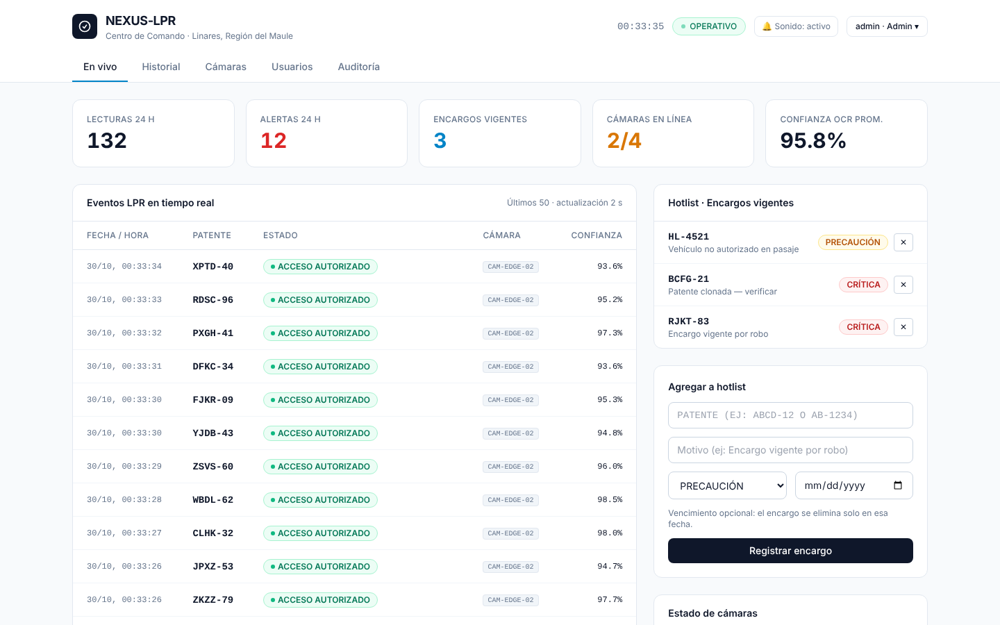

# NEXUS-LPR

Plataforma de reconocimiento automático de patentes chilenas (LPR) para seguridad
municipal y control de acceso residencial. Corre **en un equipo local** junto a las
cámaras, con acceso remoto seguro opcional. Piloto: Linares, Región del Maule.

- Lee patentes desde **cualquier cámara IP con RTSP** (no requiere cámaras LPR dedicadas).
- Formatos chilenos: autos nuevo `BBCC-12` y antiguo `AB-1234`, motos `BBC-12` / `AB-123`, con corrección de errores típicos del OCR (0/O, 8/B…).
- Cruce en tiempo real contra la **hotlist** (encargos por robo, patentes clonadas, vehículos no autorizados) → alerta en el panel con sonido + **Telegram**.
- **Foto de evidencia** solo en alertas.
- Multi-cámara con clave por cámara y monitoreo de señal.
- Usuarios (admin / operador), historial con filtros y exportación CSV.
- Cumplimiento **Ley 21.719**: retención automática, auditoría de accesos, derecho de supresión, sin video continuo ni rostros.
- Funciona sin internet; cola offline en el nodo de cámara; respaldo diario.



## Inicio rápido

**En el equipo del pasaje (producción):** ver [docs/GUIA_INSTALACION.md](docs/GUIA_INSTALACION.md).

```bash
git clone <este-repo> nexus-lpr && cd nexus-lpr && ./instalar.sh
```

**Desarrollo / demo local sin cámaras:**

```bash
npm install
node server.js                                  # muestra la contraseña de admin
node scripts/agregar-camara.js CAM-DEMO "Demo" "Pasaje Demo"
pip install -r edge/requirements.txt
NEXUS_API_KEY=<clave> python3 edge/edge_daemon.py --simulate
```

Abra http://localhost:3000.

**Probar el OCR con una foto o un video:**

```bash
python3 edge/edge_daemon.py --test-image foto-auto.jpg
NEXUS_API_KEY=<clave> RTSP_URL=video-pasaje.mp4 python3 edge/edge_daemon.py
```

## Documentación

| Documento | Contenido |
| --- | --- |
| [GUIA_INSTALACION.md](docs/GUIA_INSTALACION.md) | Instalación en terreno, cámaras, Telegram, acceso remoto, respaldos |
| [GUIA_CAMARAS.md](docs/GUIA_CAMARAS.md) | Qué comprar, cómo instalar y configurar las cámaras |
| [LEY_21719.md](docs/LEY_21719.md) | Checklist de cumplimiento y modelo de cartel |

## Estructura

```
server.js               API + panel (Express)
lib/                    base de datos, autenticación, patentes, retención, respaldos, Telegram
public/                 Centro de Comando (HTML + JS, Tailwind compilado, CSP estricta)
edge/edge_daemon.py     nodo de cámara: RTSP → OCR → confirmación → servidor
scripts/                alta de cámaras y usuarios por consola
deploy/systemd/         servicios para instalación sin Docker
docker-compose.yml      despliegue local (+ perfil "remoto" con Cloudflare Tunnel)
test/, edge/test_edge.py
```

## API

| Endpoint | Método | Auth | Descripción |
| --- | --- | --- | --- |
| `/api/alerta` | POST | API key cámara | Ingesta lectura `{patente, confianza, capturado?}`, cruza hotlist, registra evento |
| `/api/heartbeat` | POST | API key cámara | Latido de la cámara |
| `/api/eventos/:id/foto` | PUT | API key cámara | Foto JPEG de evidencia (solo alertas) |
| `/api/eventos` | GET | sesión | Últimos 50 eventos |
| `/api/resumen` | GET | sesión | KPIs de 24 h |
| `/api/hotlist` | GET / POST | sesión | Lista / agrega o actualiza `{patente, motivo, nivel, vence?}` |
| `/api/hotlist/:patente` | DELETE | sesión | Quita un encargo |
| `/api/historial` (`.csv`) | GET | sesión | Búsqueda por patente, fechas, cámara, solo alertas (auditado) |
| `/api/historial?patente=` | DELETE | admin | Supresión de datos de una patente (auditado) |
| `/api/camaras` | GET / POST | sesión / admin | Lista / registra cámara (devuelve API key) |
| `/api/usuarios` | GET / POST | admin | Usuarios del panel |
| `/api/auditoria` | GET | admin | Registro de auditoría |

Las cámaras envían el header `X-API-Key`. Niveles: `CRITICA`, `PRECAUCION`.
Estados: `ACCESO AUTORIZADO`, `LISTA NEGRA: <motivo>`.

## Tests

```bash
npm test                              # API y patentes (16 tests)
python3 -m unittest edge/test_edge.py # nodo de cámara
```
